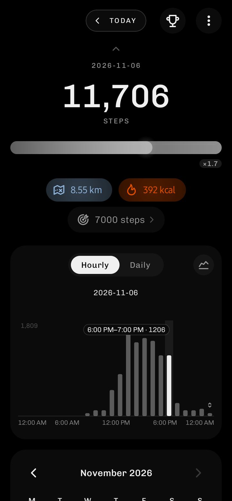
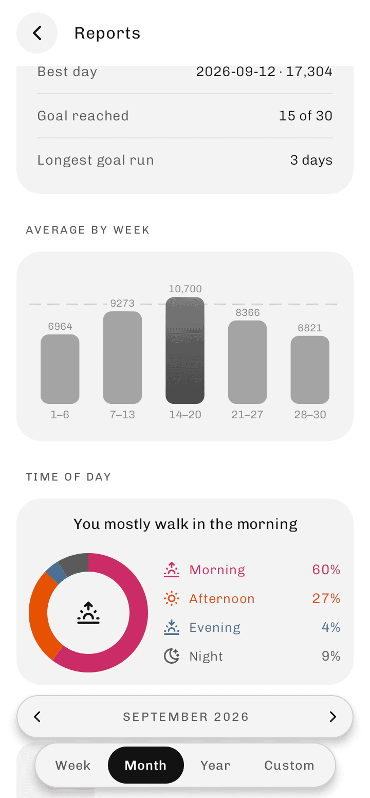
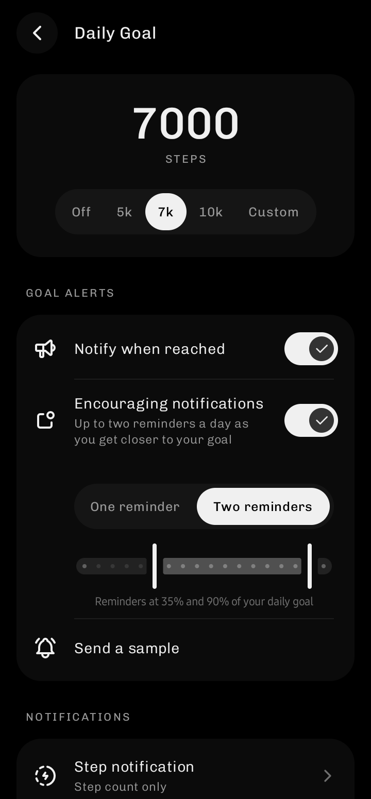
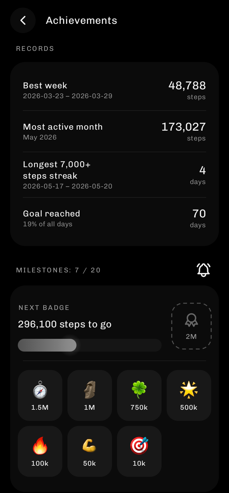
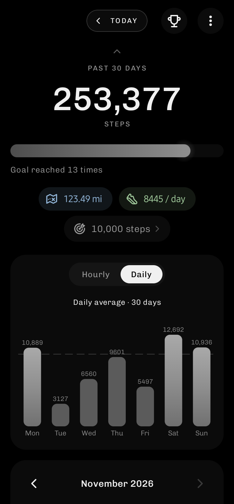
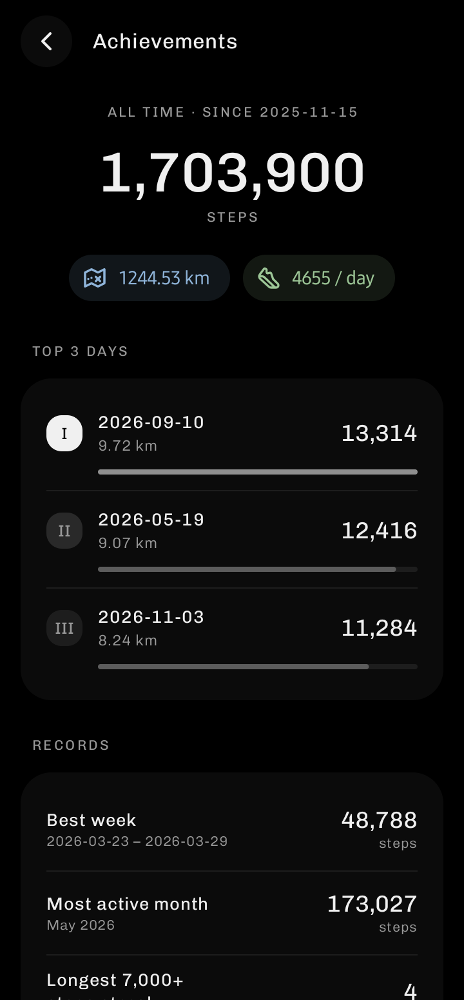
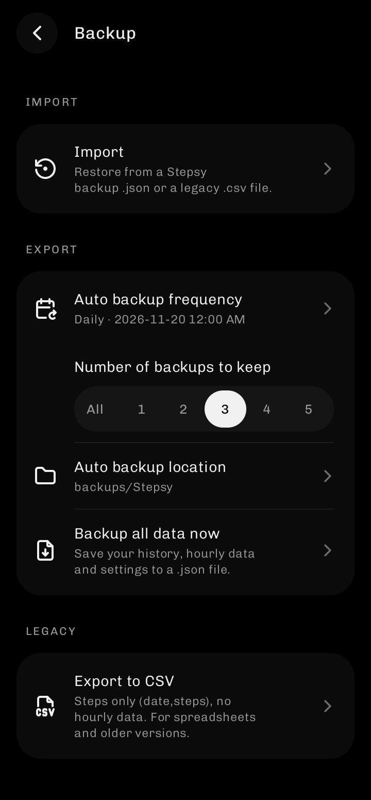
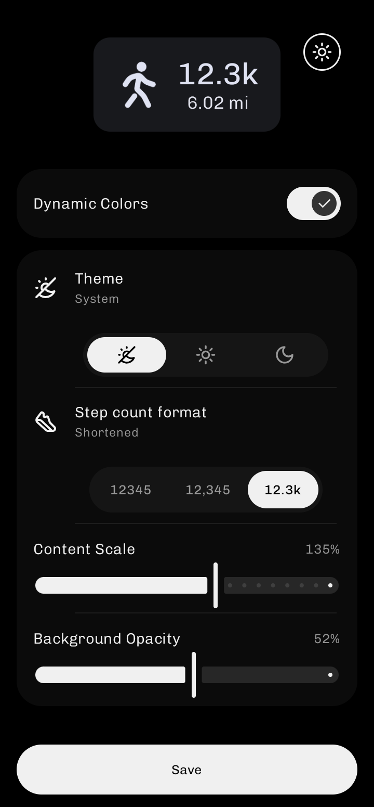
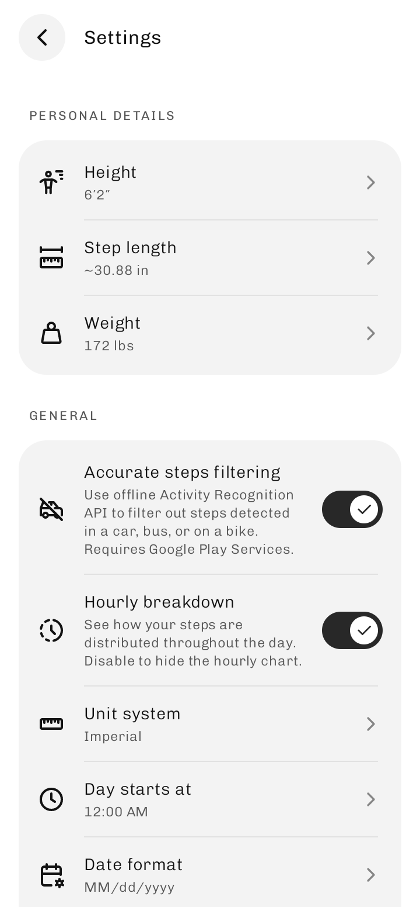

  

An advanced step counter that efficiently uses your phone's sensors.

- **Daily Goals & Streaks**: set a daily step target and build consistent walking streaks
- **Track without feeling overwhelmed**: you set the goal, optional reminders and build the routine your own way
- **Advanced reports**: compare your performance over weeks, months or years with flexible reports
- **Milestones**: earn badges by walking consistently
- **Privacy-first design**: Stepsy works completely offline with no internet access in any build
- **Reliable backups**: an advanced auto-backup system will keep your history safe
- **Widgets & Notifications**: customizable widgets and convenient notifications keep your progress at your fingertips
- **Easy on battery**: reliable and efficient step counting in your pocket. And I'm serious, it's not just an empty slogan

&nbsp;

## Build flavors

| Aspect | FOSS (Stepsy-ver-foss.apk) | Full (Stepsy-ver.apk) |
|:---:|:---:|:---:|
| Privacy | Fully offline | Fully offline |
| Proprietary dependencies | None | Google Play Services (only for optional [Activity Recognition API](https://developers.google.com/location-context/activity-recognition/)) |
| Step counting | Sensor-based tracking | Sensor-based tracking enhanced by periodic activity recognition to filter false steps (like when cycling or driving) |
| Battery usage | Optimized sensor tracking and database operations | Same as FOSS; additional API calls have negligible battery impact |
| Availability | IzzyOnDroid, F-Droid, Github (manual) | Obtainium (recommended), Github |

> You can switch freely between the FOSS and full builds without losing data.

## Screenshots

  
  
  

  
  
  

  
  
  

## Download

  
  
  

  SHA-256 Signature: <code>91e4cd099c31aeaf1bc5ed4029467eb7181d5a7dd893fd98832713ce3be58816</code>

## Custom intents

You can automate Stepsy using apps such as Tasker with broadcast intents.

| Field | Value |
| :---: | :---: |
|Intent type| broadcast|
|Package|com.nvllz.stepsy|
|Activity/Action|com.nvllz.stepsy.action.PAUSE (or RESUME)|

## Dependencies

- [Chivo](https://fonts.google.com/specimen/Chivo) – SIL OFL
- [Tabler Icons](https://github.com/tabler/tabler-icons) – MIT
- Google Play Services (full build; used only when step filtering is turned on in Settings)

## Credits

Stepsy started as a fork of [Motionmate](https://github.com/0xf4b1/motionmate) by [0xf4b1](https://github.com/0xf4b1).
